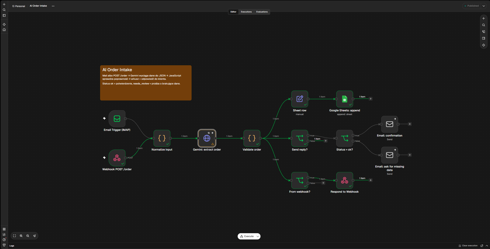
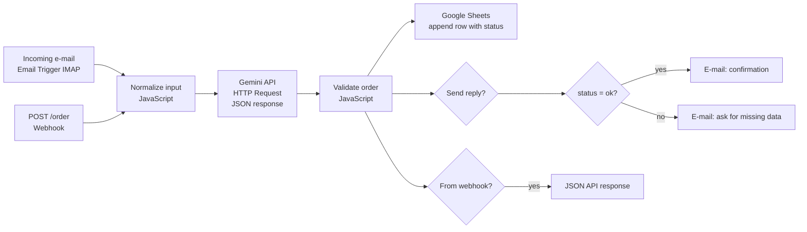
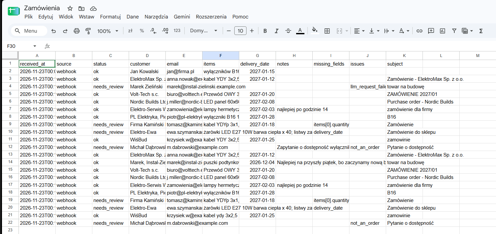

# AI Order Intake (n8n + Gemini)

**Automated order intake from e-mail.** Customers write their orders in plain text, the same way they would write to a sales rep. The system reads each order, adds it to a spreadsheet and replies to the customer within seconds.

## What it does for the business

- **No more copying e-mails into spreadsheets.** Products, quantities, delivery dates and customer details go straight into Google Sheets.
- **Customers get an instant confirmation** listing what they ordered and when it will be delivered.
- **Incomplete orders don't get lost.** If a quantity or date is missing, the order is saved with the status "needs review", and the customer automatically gets an e-mail saying exactly what information is missing.
- **Messages that aren't orders** (e.g. "do you have this in stock?") are flagged separately and passed to the sales team instead of being recorded as orders.
- **The system doesn't guess.** The AI only reads the text. Every result is then checked by regular code: are the quantities whole numbers, is the date in the future, is the e-mail address valid? Anything uncertain goes to a person.
- Orders can also come **from other systems** (an online shop, a web form) through an API endpoint.
- Works with **Polish and English** e-mails and replies in the customer's language.

**Example:** a customer writes *"wrzućcie mi 10 opakowań puszek fi60 i 5 rolek taśmy na przyszły piątek"* ("send me 10 packs of fi60 junction boxes and 5 rolls of tape for next Friday"). A row with two items and an exact date appears in the sheet, and the customer receives a confirmation e-mail.



---

## How it works



| Node | What it does |
|---|---|
| **Email Trigger (IMAP)** | Watches the inbox and picks up new, unread e-mails. |
| **Webhook POST /order** | Accepts orders over a REST API: `{ "name", "email", "subject", "text" }`. |
| **Normalize input** (Code) | Converts e-mails and API requests into one common format, extracts the sender's address, and builds the prompt and JSON schema for the model. |
| **Gemini: extract order** (HTTP Request) | Calls the Gemini REST API (`generateContent`) with `responseMimeType: application/json` and a `responseSchema`, so the model must return JSON in a fixed shape. The API key is stored in a Header Auth credential (`x-goog-api-key`), not in the node itself. On failure it retries 3 times, then passes the error on instead of stopping the workflow. |
| **Validate order** (Code) | Parses the model's response and checks the data: quantities are positive integers, the date is a real date and not in the past, the e-mail address is valid, and the item list isn't empty. Sets the status to `ok` or `needs_review` and builds the reply (in Polish or English, matching the e-mail). It never throws: broken JSON, an empty response or an HTTP error all end in `needs_review`. Never replies to automated addresses such as `no-reply@…`. |
| **Sheet row** + **Google Sheets: append** | Selects the columns and appends a row to the sheet, including orders that need review. |
| **Send reply?** | Skips sending when there is no reply address or the request has `dry_run: true` (test mode). |
| **Status = ok?** | Routes to the confirmation e-mail or the missing-data e-mail. |
| **Email: confirmation / ask for missing data** | Send the reply through Gmail SMTP. |
| **From webhook?** + **Respond to Webhook** | Returns the result as JSON when the order came in through the API. |

The code for both Code nodes lives in `src/` and has unit tests. `scripts/build-workflow.js` injects the same code into `workflow.json`, so what is tested is exactly what runs in n8n.

### API response

```bash
curl -X POST http://localhost:5678/webhook/order \
  -H "Content-Type: application/json" \
  -d '{"name":"Jan Kowalski","email":"jan@firma.pl","text":"Proszę o 20 wyłączników B16 na 15 stycznia 2027","dry_run":true}'
```

```json
{
  "status": "ok",
  "issues": [],
  "missing_fields": [],
  "order": {
    "customer": "Jan Kowalski",
    "email": "jan@firma.pl",
    "items": [{ "product": "wyłącznik B16", "quantity": 20 }],
    "delivery_date": "2027-01-15",
    "notes": null
  }
}
```

Possible values in `issues`: `not_an_order`, `delivery_date_in_past`, `delivery_date_invalid`, `email_invalid_format`, `items[N].quantity_not_positive_integer`, `llm_invalid_json`, `llm_empty_response`, `llm_request_failed`.

---

## Test results

10 sample e-mails in `samples/`: 6 valid orders (one of them in English), 2 missing a quantity or date, 1 with typos, and 1 that isn't an order. The expected results are in `samples/expected.json`. The `npm run eval` script sends every e-mail to the webhook and compares the results.

Result: **10/10** cases matched expectations (2026-11-23).

| E-mail | Expected status | Actual status | Items | Missing / issues | Result |
|---|---|---|---|---|---|
| 01_ok_formal.txt | ok | ok | 3 | - | ✅ |
| 02_ok_casual.txt | ok | ok | 2 | - | ✅ |
| 03_ok_list.txt | ok | ok | 4 | - | ✅ |
| 04_ok_english.txt | ok | ok | 3 | - | ✅ |
| 05_ok_signature_email.txt | ok | ok | 2 | - | ✅ |
| 06_ok_one_line.txt | ok | ok | 1 | - | ✅ |
| 07_missing_quantity.txt | needs_review | needs_review | 2 | items[0].quantity | ✅ |
| 08_missing_date.txt | needs_review | needs_review | 2 | delivery_date | ✅ |
| 09_ok_typos.txt | ok | ok | 2 | - | ✅ |
| 10_not_an_order.txt | needs_review | needs_review | 0 | not_an_order | ✅ |

In the first run (9/10), one Gemini request (`02_ok_casual.txt`, with the relative date "next Friday") hit the 30-second timeout. The workflow kept running: it retried three times, then marked the order `needs_review` with the reason `llm_request_failed`. After that, the HTTP Request timeout was raised to 60 seconds.

There are also 15 unit tests for the validation code (`npm test`), covering cases such as: no replies to no-reply addresses, broken JSON from the model, a response wrapped in a Markdown code block, HTTP errors, February 30th, and negative or fractional quantities.



---

## Setup

### 1. n8n

```bash
docker compose up -d
```

Open `http://localhost:5678` and create a local account. Create a new workflow, open the **…** menu and choose **Import from File**, then select `workflow.json`.

### 2. Credentials

| Credential | Type in n8n | Settings |
|---|---|---|
| Gemini API key | Header Auth | Name: `x-goog-api-key`, Value: key from [Google AI Studio](https://aistudio.google.com/apikey) |
| Test inbox (receiving) | IMAP | `imap.gmail.com`, port 993, SSL, user = Gmail address, password = **app password** |
| Test inbox (sending) | SMTP | `smtp.gmail.com`, port 465, SSL, same app password |
| Google Sheets | Google Sheets OAuth2 | see the [n8n guide](https://docs.n8n.io/integrations/builtin/credentials/google/oauth-single-service/) |

App password: enable 2-Step Verification on the test Gmail account, then go to Google Account → Security → App passwords.

After assigning credentials:
- in both **Email: …** nodes, enter your test address in the *From Email* field;
- in the **Google Sheets: append** node, pick the spreadsheet and sheet, and keep *Mapping Column Mode* set to **Map Automatically**.

### 3. Spreadsheet

The first row of the sheet must contain these headers:

```
received_at | source | status | customer | email | items | delivery_date | notes | missing_fields | issues | subject
```

### 4. Publish and test

Click **Publish** in the top-right corner of the editor (in n8n 2.x this replaces the old *Active* toggle). Then run:

```bash
npm test        # validation unit tests, no n8n needed
npm run eval    # 10 e-mails through the webhook, results in results/eval-results.md
```

`npm run eval` sends `dry_run: true` by default, so orders are written to the sheet, but no e-mails go out to the (fictional) customers. To test real e-mails, send a message to the test inbox from another account.

The model is set in `src/normalize.js` (`GEMINI_MODEL`, the `gemini-flash-latest` alias by default). After changing it, run `npm run build` and import the workflow again.

---

## Limitations

- **No catalogue check.** The system doesn't verify that a product exists or is in stock. The next step would be looking up each product in a product database or warehouse API before confirming.
- **The webhook has no authentication.** That's fine locally. Before exposing it publicly, add Header Auth to the Webhook node.
- **A customer's reply with the missing data** arrives as a new e-mail and is processed from scratch, without being linked to the original order.
- **Attachments** (e.g. an order sent as a PDF or Excel file) are not read.
- **The model can make mistakes** with unusual wording, e.g. confusing a unit with a quantity. Validation catches formal errors but not every factual one, which is why the confirmation sent to the customer includes the full item list for them to check.
- If writing to Google Sheets fails, the execution ends with an error visible in the *Executions* tab, and a webhook request gets an error instead of a response.

## Repository structure

```
workflow.json              workflow export to import into n8n
docker-compose.yml         runs n8n
src/normalize.js           code of the "Normalize input" node
src/validate.js            code of the "Validate order" node
scripts/build-workflow.js  builds workflow.json from src/
scripts/run-eval.js        evaluation on the 10 sample e-mails
tests/                     unit tests (node --test)
samples/                   sample e-mails + expected results
docs/                      screenshots
```
