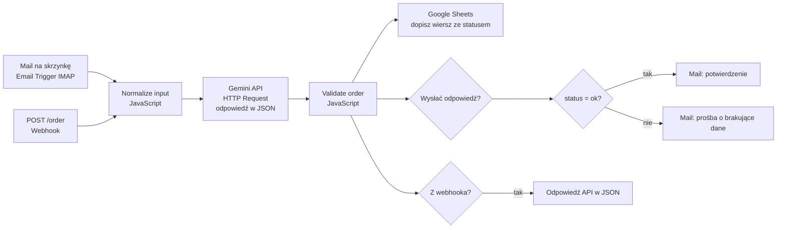

# AI Order Intake (n8n + Gemini)

**Automatyczne przyjmowanie zamówień z maili.** Klient pisze zamówienie zwykłym tekstem, tak jak pisze do handlowca. System sam je odczytuje, wpisuje do arkusza i odpowiada klientowi w ciągu kilkunastu sekund.

## Co to robi dla firmy

- **Handlowiec nie przepisuje maili do arkusza.** Produkty, ilości, termin dostawy i dane klienta trafiają do Google Sheets automatycznie.
- **Klient od razu dostaje potwierdzenie** z listą tego, co zamówił, i terminem dostawy.
- **Niekompletne zamówienia nie giną.** Jeśli brakuje ilości albo daty, system dopisuje zamówienie ze statusem „do weryfikacji” i sam prosi klienta o brakujące dane, wymieniając, czego dokładnie brakuje.
- **Pytania, które nie są zamówieniami** (np. „czy macie to na stanie?”), są oznaczane osobno i przekazywane do działu sprzedaży, a nie wpisywane jako zamówienie.
- **System nie zgaduje.** Sztuczna inteligencja tylko odczytuje tekst, a każdy wynik sprawdza zwykły program: czy ilości są liczbami, czy data nie minęła, czy e-mail jest poprawny. Wątpliwe przypadki zawsze trafiają do człowieka.
- Zamówienia można też wysyłać **z innego systemu** (sklep internetowy, formularz) przez adres API.

**Przykład:** klient pisze „wrzućcie mi 10 opakowań puszek fi60 i 5 rolek taśmy na przyszły piątek”. W arkuszu pojawia się wiersz z dwiema pozycjami i konkretną datą, a klient dostaje maila z potwierdzeniem.


---

## Jak to działa



| Węzeł | Co robi |
|---|---|
| **Email Trigger (IMAP)** | Co chwilę sprawdza skrzynkę i pobiera nowe, nieprzeczytane maile. |
| **Webhook POST /order** | Przyjmuje zamówienie przez REST API: `{ "name", "email", "subject", "text" }`. |
| **Normalize input** (Code) | Sprowadza mail i zapytanie API do jednego formatu, wyciąga adres nadawcy, buduje prompt i schemat JSON dla modelu. |
| **Gemini: extract order** (HTTP Request) | Wywołuje REST API Gemini (`generateContent`) z `responseMimeType: application/json` i `responseSchema`, więc model musi zwrócić JSON w ustalonym kształcie. Klucz API jest w Credential typu Header Auth (`x-goog-api-key`), a nie w treści węzła. Przy błędzie ponawia próbę 3 razy, potem przepuszcza błąd dalej zamiast zatrzymywać workflow. |
| **Validate order** (Code) | Parsuje odpowiedź modelu i sprawdza dane: ilości to dodatnie liczby całkowite, data jest prawdziwą datą i nie wypada w przeszłości, e-mail ma poprawny format, lista produktów nie jest pusta. Ustala status `ok` albo `needs_review` i przygotowuje treść odpowiedzi (PL lub EN, zależnie od języka maila). Nigdy nie rzuca wyjątku: zepsuty JSON, pusta odpowiedź czy błąd HTTP kończą się statusem `needs_review`. |
| **Sheet row** + **Google Sheets: append** | Wybiera kolumny i dopisuje wiersz do arkusza, także dla zamówień do weryfikacji. |
| **Send reply?** | Pomija wysyłkę, gdy nie ma adresu zwrotnego albo gdy zapytanie ma `dry_run: true` (tryb testowy). |
| **Status = ok?** | Kieruje do maila z potwierdzeniem albo do maila z prośbą o brakujące dane. |
| **Email: confirmation / ask for missing data** | Wysyłają odpowiedź przez SMTP Gmaila. |
| **From webhook?** + **Respond to Webhook** | Gdy zamówienie przyszło przez API, zwraca wynik w JSON. |

Kod obu węzłów Code jest w `src/` i ma testy jednostkowe. `scripts/build-workflow.js` wkleja ten sam kod do `workflow.json`, więc to, co jest testowane, jest tym, co działa w n8n.

### Odpowiedź API

```bash
curl -X POST http://localhost:5678/webhook/order \
  -H "Content-Type: application/json" \
  -d '{"name":"Jan Kowalski","email":"jan@firma.pl","text":"Proszę o 20 wyłączników B16 na 15 stycznia 2027","dry_run":true}'
```

```json
{
  "status": "ok",
  "issues": [],
  "missing_fields": [],
  "order": {
    "customer": "Jan Kowalski",
    "email": "jan@firma.pl",
    "items": [{ "product": "wyłącznik B16", "quantity": 20 }],
    "delivery_date": "2027-01-15",
    "notes": null
  }
}
```

Możliwe wartości w `issues`: `not_an_order`, `delivery_date_in_past`, `delivery_date_invalid`, `email_invalid_format`, `items[N].quantity_not_positive_integer`, `llm_invalid_json`, `llm_empty_response`, `llm_request_failed`.

---

## Wyniki testów

10 przykładowych maili w `samples/` (6 poprawnych, w tym jeden po angielsku, 2 bez ilości lub daty, 1 z literówkami, 1 niebędący zamówieniem). Oczekiwane wyniki są w `samples/expected.json`, a skrypt `npm run eval` wysyła wszystkie maile na webhook i porównuje wyniki.

Wynik: **10/10** przypadków zgodnych z oczekiwaniami (2026-11-23).

| Mail | Oczekiwany status | Otrzymany status | Pozycji | Braki / problemy | Wynik |
|---|---|---|---|---|---|
| 01_ok_formal.txt | ok | ok | 3 | - | ✅ |
| 02_ok_casual.txt | ok | ok | 2 | - | ✅ |
| 03_ok_list.txt | ok | ok | 4 | - | ✅ |
| 04_ok_english.txt | ok | ok | 3 | - | ✅ |
| 05_ok_signature_email.txt | ok | ok | 2 | - | ✅ |
| 06_ok_one_line.txt | ok | ok | 1 | - | ✅ |
| 07_missing_quantity.txt | needs_review | needs_review | 2 | items[0].quantity | ✅ |
| 08_missing_date.txt | needs_review | needs_review | 2 | delivery_date | ✅ |
| 09_ok_typos.txt | ok | ok | 2 | - | ✅ |
| 10_not_an_order.txt | needs_review | needs_review | 0 | not_an_order | ✅ |

W pierwszym przebiegu (9/10) jedno zapytanie do Gemini (`02_ok_casual.txt`, data względna „na przyszły piątek”) przekroczyło limit 30 s. Workflow nie przerwał działania: trzy razy ponowił próbę, a potem oznaczył zamówienie statusem `needs_review` z powodem `llm_request_failed`. Po tym limit czasu w węźle HTTP Request został podniesiony do 60 s.

Do tego 15 testów jednostkowych walidacji (`npm test`), w tym: brak odpowiedzi na adresy no-reply, zepsuty JSON z modelu, odpowiedź w bloku Markdown, błąd HTTP, data 30 lutego, ilość ujemna i ułamkowa.


---

## Uruchomienie

### 1. n8n

```bash
docker compose up -d
```

Otwórz `http://localhost:5678` i załóż konto lokalne. W menu workflow wybierz **Import from File** i wskaż `workflow.json`.

### 2. Credentials

| Credential | Typ w n8n | Ustawienia |
|---|---|---|
| Gemini API key | Header Auth | Name: `x-goog-api-key`, Value: klucz z [Google AI Studio](https://aistudio.google.com/apikey) |
| Skrzynka testowa (odbiór) | IMAP | `imap.gmail.com`, port 993, SSL, użytkownik = adres Gmail, hasło = **hasło aplikacji** |
| Skrzynka testowa (wysyłka) | SMTP | `smtp.gmail.com`, port 465, SSL, to samo hasło aplikacji |
| Google Sheets | Google Sheets OAuth2 | według [instrukcji n8n](https://docs.n8n.io/integrations/builtin/credentials/google/oauth-single-service/) |

Hasło aplikacji: na testowym koncie Gmail włącz weryfikację dwuetapową, potem Konto Google → Bezpieczeństwo → Hasła aplikacji.

Po przypisaniu credentials:
- w obu węzłach **Email: …** wpisz swój adres testowy w polu *From Email*;
- w węźle **Google Sheets: append** wskaż arkusz i zakładkę.

### 3. Arkusz

Pierwszy wiersz arkusza musi zawierać nagłówki:

```
received_at | source | status | customer | email | items | delivery_date | notes | missing_fields | issues | subject
```

### 4. Aktywacja i test

Aktywuj workflow (przełącznik w prawym górnym rogu), potem:

```bash
npm test        # testy jednostkowe walidacji, bez n8n
npm run eval    # 10 maili przez webhook, wynik w results/eval-results.md
```

`npm run eval` domyślnie wysyła `dry_run: true`, więc zamówienia trafiają do arkusza, ale maile do (fikcyjnych) klientów nie są wysyłane. Żeby przetestować prawdziwe maile, wyślij wiadomość na skrzynkę testową z innego konta.

Model ustawiasz w `src/normalize.js` (`GEMINI_MODEL`, domyślnie alias `gemini-flash-latest`). Po zmianie uruchom `npm run build` i zaimportuj workflow ponownie.

---

## Ograniczenia

- **Zgodność danych z katalogiem.** System nie sprawdza, czy produkt istnieje w ofercie ani czy jest na stanie. Następny krok to wyszukanie produktu w bazie lub API magazynu przed potwierdzeniem.
- **Webhook nie ma uwierzytelnienia.** Wystarcza lokalnie. Przed wystawieniem na zewnątrz trzeba dodać Header Auth w węźle Webhook.
- **Odpowiedź klienta na prośbę o dane** trafia jako nowy mail i jest przetwarzana od zera, bez łączenia z pierwotnym zamówieniem.
- **Załączniki** (np. zamówienie w PDF lub Excelu) nie są czytane.
- **Model może się pomylić** przy nietypowych sformułowaniach, np. pomylić jednostkę z ilością. Walidacja wyłapuje błędy formalne, ale nie każdy błąd merytoryczny, dlatego potwierdzenie wysyłane do klienta zawiera pełną listę pozycji do sprawdzenia.
- Jeśli zapis do Google Sheets się nie powiedzie, wykonanie kończy się błędem widocznym w zakładce *Executions*, a zapytanie z webhooka dostaje błąd zamiast odpowiedzi.

## Struktura repozytorium

```
workflow.json            eksport workflow do zaimportowania w n8n
docker-compose.yml       uruchomienie n8n
src/normalize.js         kod węzła "Normalize input"
src/validate.js          kod węzła "Validate order"
scripts/build-workflow.js  składa workflow.json z src/
scripts/run-eval.js      ewaluacja na 10 przykładowych mailach
tests/                   testy jednostkowe (node --test)
samples/                 przykładowe maile + oczekiwane wyniki
docs/                    zrzuty ekranu
```
